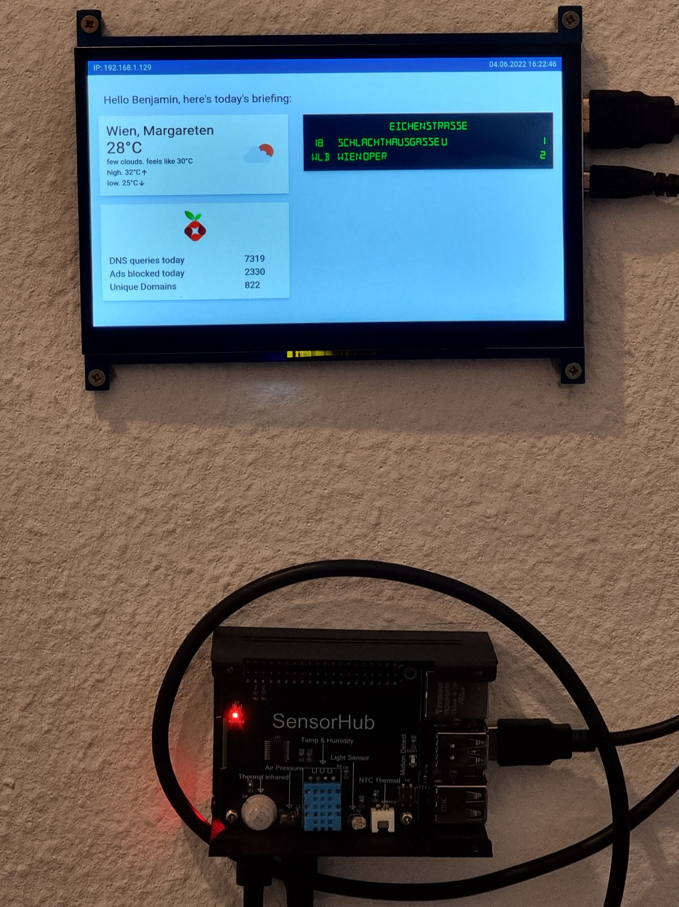

# Raspberry Pi dashboard

A native Rust dashboard with weather, Wiener Linien departures, Pi-hole statistics,
a clock, and network status. Built with egui for Wayland.



## Requirements

- Raspberry Pi 4/5 or a Linux computer with a Wayland session
- Screen (1024×600 or larger)
- Rust 1.95 or newer
- Internet connection for weather, departures, and location searches

## Recommended

- EP-0106 Sensor Hub Development board for automatic screen wake and sleep
- A compositor supporting idle notifications and output power management, such as
  labwc, for automatic screen power control

## Setup

Install the build dependencies on Raspberry Pi OS or Debian:

```sh
sudo apt install build-essential pkg-config libssl-dev libwayland-dev libxkbcommon-dev libegl1-mesa-dev libgl1-mesa-dev ca-certificates
```

Clone, build, and run the application from your graphical session:

```sh
git clone https://github.com/RaederDev/iot-display.git
cd iot-display
cargo build --release --locked
./target/release/iot-display
```

The app opens settings on first launch and starts fullscreen by default. Use
`--windowed` for a window or `--debug` to log outgoing HTTP requests.
For automatic startup, add the executable to your desktop session's autostart.

## Configuration

Open Settings in the app or press **Ctrl+,**. Configure widgets, arrange the
layout, and choose the theme, scale, and fullscreen behavior. Save applies changes;
Cancel discards them.

- **Weather:** search for a location or enter coordinates. Uses Open-Meteo without an API key.
- **Departures:** search Wiener Linien stops by name or DIVA number and select lines.
- **Pi-hole:** enter a Pi-hole v6 API URL ending in `/api` and an application password.

Settings are saved in `~/.config/iot-display/config.json` (or under
`$XDG_CONFIG_HOME`). The Pi-hole password is stored in this file in plain text.
Cached data remains visible while offline.

## Automatic screen wake and sleep

With an EP-0106 board connected, enable I²C in `raspi-config` and give your session
user access to the `i2c` group. Disable competing desktop screen-blanking rules,
then enable **Automatic screen wake and sleep** in Settings → General.
Availability is shown beside the setting.

The screen sleeps after ten minutes without presence or input. Presence wakes
it, with a five-minute cooldown between sensor wakes; keyboard, mouse, and touch
input can always wake it. The feature is off by default and requires the app to
remain running.

## Updating

From the project directory:

```sh
git pull
cargo build --release --locked
```

Restart the app to use the new build.

## Credits

- Weather: [Open-Meteo](https://open-meteo.com/).
- Wiener Linien real-time data: Datenquelle: Stadt Wien – https://data.wien.gv.at.
- Pi-hole logo: [Pi-hole](https://pi-hole.net/).
- Fonts: Roboto and DSEG; see [asset licenses](assets/README.md).
