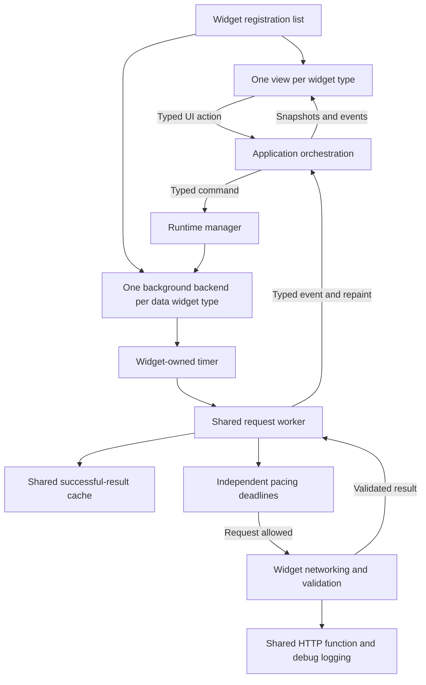
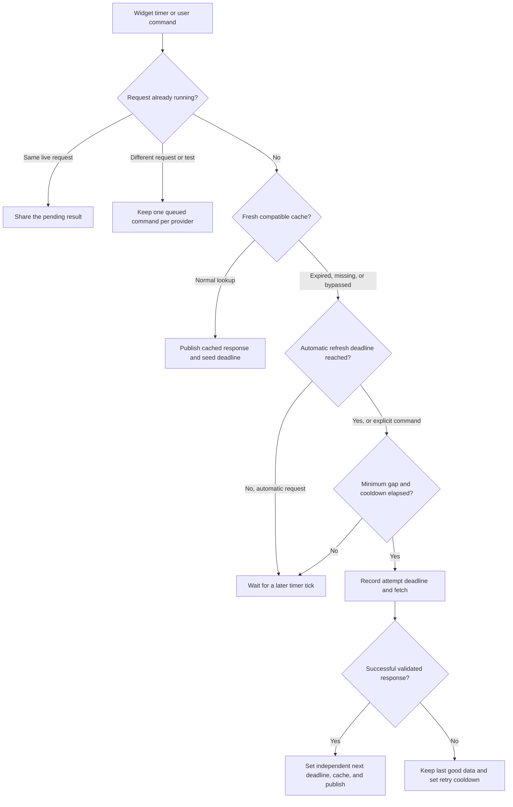

# Widget architecture and refresh flow

One UI thread renders the dashboard. One background Tokio runtime hosts a task
for each registered data widget type and an application-level screen-power
controller. The application arranges widgets, edits
layout/appearance, saves configuration, and routes commands and results.

`src/widgets/registry.rs` contains the registration list. The same list supplies
layout choices, rendering, settings tabs, status-bar contributions, validation,
fonts, request identities, and background backend factories. Removing a
registration removes those contributions together. Existing layout entries for
an unregistered widget show an unavailable prompt.

Each widget is kept together:

```text
src/widgets/widget_pihole/
    mod.rs       registration and view adapter
    config.rs    configuration defaults and validation
    settings.rs  settings controls
    ui.rs        dashboard presentation
    data.rs      response model, HTTP calls, and authentication
    timer.rs     fixed refresh policy, cache identity, and session lifecycle
    assets/      embedded artwork
```

Weather and departures follow the same arrangement. Weather owns its location
search editor; departures owns its stop editor and navigation state. Clock and
greeting need only UI/settings code. Network enumeration has its own widget and
can contribute to the status bar. Duplicate cards use the same backend and cache
identity; each departure card has separate navigation state.

| Shared code | Responsibility |
| --- | --- |
| `widgets/registry.rs`, `backend.rs`, `common.rs` | Registration, small view/backend interfaces, card framing, and common data status |
| `runtime/manager.rs` | Start registered backends, route requests, and coordinate shutdown/cache clearing |
| `runtime/worker.rs` | Run a backend's timer, publish cached data, coalesce work, cancel obsolete requests, and report results |
| `runtime/pacing.rs` | Independent monotonic attempt and automatic-refresh deadlines |
| `runtime/messages.rs`, `integrations/requests.rs` | Typed command/result protocol and request parameters |
| `integrations/mod.rs` | Typed data/provider protocol; compatibility exports point to widget-owned models |
| `ui/app/`, `ui/settings/`, `ui/dashboard/` | Application actions, settings shell, and row/column composition |
| `ui/data.rs` | Latest successful UI snapshots and errors |
| `config/` | Root configuration persistence and layout editing |
| `cache.rs`, `http.rs`, `storage.rs` | Shared successful-result cache, logged HTTP client, and atomic private files |
| `screen_power/` | Optional presence/input policy, EP-0106 I²C reads, native Wayland idle notifications and output power control |

Views return `UiAction` values. The application handles them after rendering.
Settings use a draft until Save succeeds; Cancel discards the draft. Preview
uses the same widget rendering code and snapshots without issuing requests.
Connection tests use draft requests and temporary Pi-hole sessions, and never
replace dashboard cache entries.



## Scheduling and protection against cache failures

Every data widget owns a Tokio timer. Its one-second ticks check whether work is
due; they are not network polling intervals. Fixed periods live in match
statements in that widget's `timer.rs`: weather one hour, departures five minutes,
Pi-hole/network one minute, catalogue seven days, and searches thirty days.
They are absent from configuration and cannot be edited by users.

A fresh cached response is published immediately and seeds an independent deadline
using its original fetch time. A successful fetch establishes the next deadline
before attempting to persist its cache entry. Removing a cache entry, failing to
save a file, or accidentally declaring data stale cannot cause another automatic
request until that deadline. Weather shortens its deadline to the next midnight
in the location's timezone, independently of the response's reported date.

Requests also have a five-second minimum gap per provider, recorded before work
starts. Errors impose 30–300 second backoff, or the server's Retry-After cooldown.
These guards use monotonic time and survive cancellation, Save, and Clear cache.
Changed parameters make a new request eligible, but keep the minimum gap and
cooldowns. Credential changes invalidate the previous Pi-hole statistics deadline
and session, while preserving these guards. Authentication renewal and redirect
attempts are part of a single integration fetch, and every HTTP attempt is logged
when debug output is enabled.



Refresh bypasses the automatic deadline and freshness for currently used live
integrations. It shares existing requests and queues behind minimum gaps or
cooldowns; it does not reload the catalogue. Repeated clicks keep one queued
refresh per provider. Searches honor cached search results and queue the latest
query when needed. A queued connection test takes precedence over a refresh.
Clear cache first pauses and drains every writer, clears once, and resumes the
backends with explicit lookups while retaining pacing protection.

Save cancels pending work and advances a configuration generation. Data, failures,
and test results carry that generation; the UI discards older events. Search
results must also match the widget editor's current query, preventing late results
from reopening a cleared search. Departure filtering, countdowns, and navigation
are local operations. Clocks/countdowns request their own repaints; the app has
no global continuous repaint loop.

## Screen power

Screen power is application infrastructure, independent of widget layout,
refresh, and cache clearing. `runtime/manager.rs` forwards the saved toggle over
a watch channel; a separate typed status event updates General settings without
overwriting dashboard notices. Draft changes have no hardware effects.

The controller holds its own Wayland connection, integrated with Tokio socket
readiness. It subscribes to ten-minute `ext-idle-notify-v1` notifications for every
advertised input seat; those notifications respect compositor idle inhibitors.
It requires all seats idle and a ten-minute monotonic absence interval before
blanking all outputs through `wlr-output-power-management-v1`. Normal input
resumes wake the outputs; a sensor wake also requires its five-minute cooldown
to have elapsed. Positive sensor readings always extend the absence deadline.

The adapter tracks each output's reported state, pending target/deadline, and
whether the app blanked it. Power requests coalesce and require acknowledgement
within two seconds. Missing protocols, output rejection/hotplug, or failed sensor
reads suspend automatic blanking. Recovery starts a fresh grace period, and
disabling, failure, and normal shutdown restore only app-blanked outputs where
possible. Outstanding restore ownership survives reconnects within the session.

I²C reads use the blocking pool, with a two-second supervisory deadline and at
most one outstanding read. A late result is discarded after timeout; retries
wait for the outstanding read to finish. Runtime shutdown caps its wait for
blocking work. Availability probes run every 30 seconds while disabled or
unavailable. Policy tests use explicit monotonic times; an in-process Wayland
test server exercises the real protocol adapter without controlling the desktop.

## Adding a widget

1. Create `src/widgets/widget_<name>/` with its view, settings, configuration,
   models/networking, and timer as needed. Implement the small `View` interface
   and, for data widgets, `Backend`.
2. Define its registration in `mod.rs` and add it to `REGISTERED`.
3. Add its typed widget/configuration fields and, if it fetches data, the relevant
   `Provider`, `Request`, and `Data` variants. These explicit enums are the shared
   JSON/message schema; there is no plugin loader or untyped message bus.
4. Test parsing/policy inside the widget and add interaction or mock HTTP tests
   for any new behavior. The app's rendering/settings dispatch does not need a
   widget-specific branch.

Headless interaction tests live under `src/ui/app/tests/`. Runtime tests cover
cache loss, failed persistence, independent deadlines, coalescing, and queued
tests. HTTP tests use fixtures, a local mock server, and captured stdout without
live credentials.
